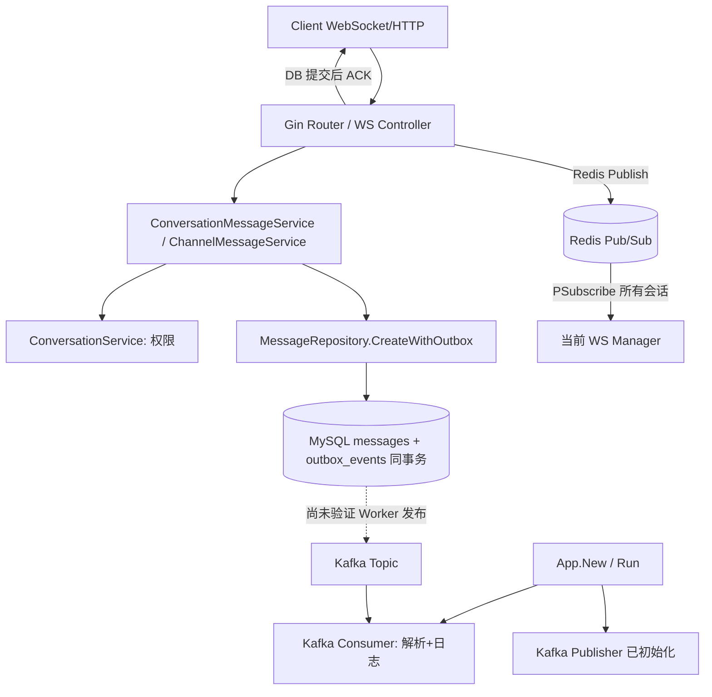
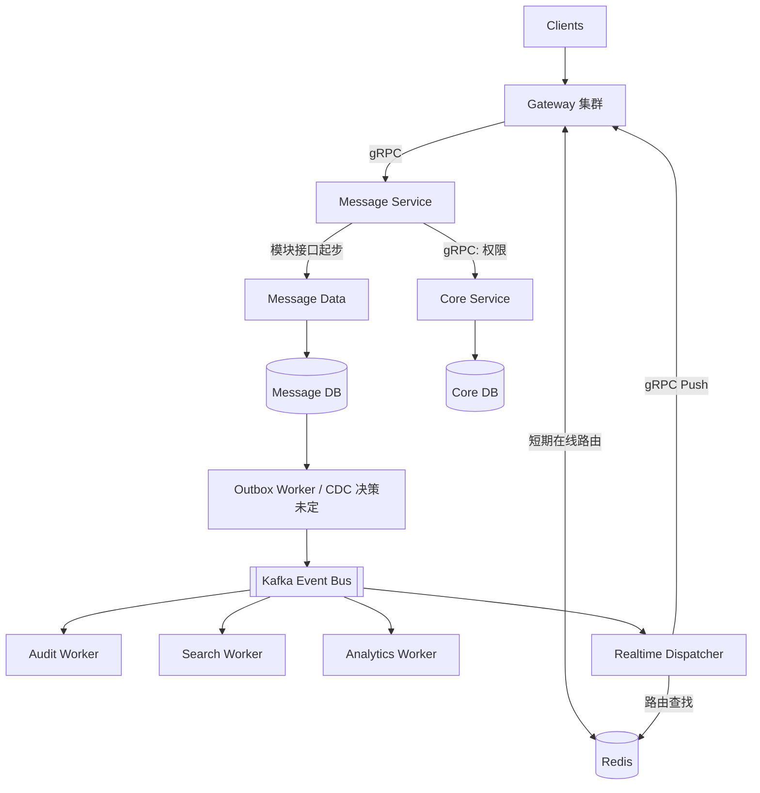

# GoHub As-Is / To-Be 架构

基线：`main@ff9d710`（2026-10-15）；**图是源码阅读得出的逻辑简化，尚未作当前环境的端到端测试**。

## 现状 As-Is

证据：`internal/router/router.go`、`internal/controller/ws_message_handle.go`、`internal/service/conversation_message_service.go`、`internal/repository/message_repository.go`、`internal/app/app.go`、`internal/messaging/message_created_consumer.go`。

> 注意：图中的 `Kafka Publisher` 是已有构造能力，不代表消息创建流程正在成功向 Kafka 生产；两类 Message Service 原先的 best-effort 发布调用在远程基线中被注释。Kafka Consumer 也还没有审计入库副作用。

## 目标 To-Be（规划，不是当前实现）

## 单条消息的边界

1. 发送端要求的是数据库已持久化 ACK，不是 Kafka 已投递 ACK。
2. MySQL 事务同时写 `messages` 与 `outbox_events`，为可靠异步提供基础；实际发布和重试逻辑需要 Worker 才闭环。
3. 客户端 Delivered / Read 与 Kafka Consumer 的 Offset 不是同一概念。
4. Redis Pub/Sub 不是持久存储；断线必须依赖 `/sync` 历史补拉。
5. 早期继续复用单仓库、单 MySQL 实例，先确立接口和表归属；不立即重构所有目录。

## 与目标的差距（M01 不实现，只形成风险台账）

- Outbox Worker 未在远程 main 发现；用户本地可能有版本。
- Audit 无幂等业务写入，当前 Consumer 只解析并 `slog.Debug`。
- Redis Broker 全局模式订阅，未来需要节点目录和定向路由。
- App 创建时 Kafka Publisher / Consumer 都会 Ping；可能放大 Kafka 故障对聊天启动的影响。
- 尚无 `.proto` / gRPC 独立服务与网关调用链。
- Conversation List 使用 `last_messages` 全局分组，缺乏基于真实负载的性能证据。
